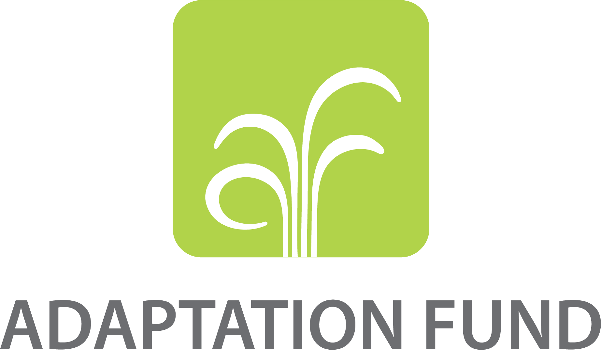
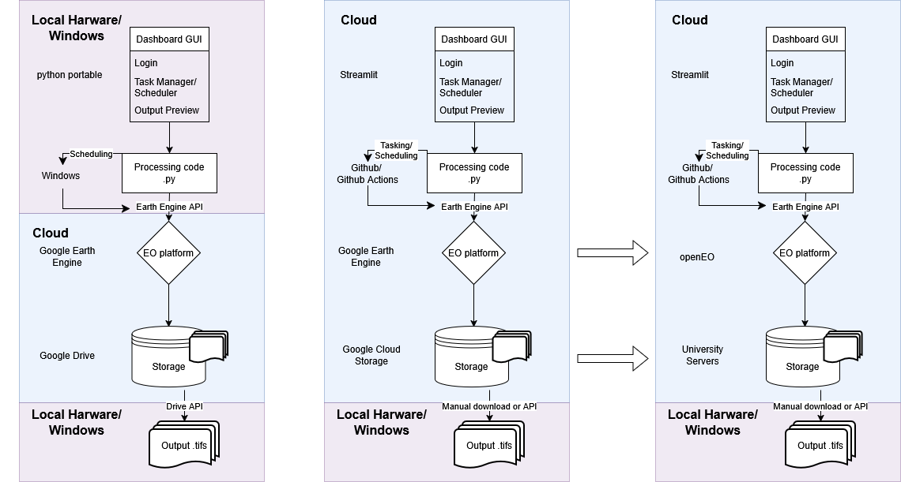

# Transient Hydrologic Anomalies Weekly (THAW) 
*A tool for the detection and monitoring of anomalous and potentially hazardous water bodies*

<p align="center">
  
  
  
  
  
</p>

**THAW** is an automated pipeline and dashboard for monitoring surface water bodies over time using **Sentinel-1 Synthetic Aperture Radar (SAR)** and **Google Earth Engine (GEE)**. This version is designed to run locally via a portable Python environment, supporting both manual processing for specific dates and scheduled, recurring background tasks. Tracking of lakes back in time is also supported. No coding-skills or only low-level GIS-skills needed.

*Note: Choose this version if you want to use the tool locally with your own google earth engine account and google drive storage, and if you want the result-images to download automatically to your local computer*

---

[](https://youtu.be/Eg3_Jr2FksA)

## Features Overview
- **Surface Water Detection** from Synthetic Aperture Radar (Sentinel1-SAR) data given a user-define area of interest (AOI). Determination of the anomaly of the latest backscatter data to historic backscatter phenology in each pixel, expressed as a composite z-score for the ascending and descending orbits. Unlike optical satellites, Sentinel-1 radar penetrates clouds and delivers observations also during nighttimes, making it ideal for monitoring flooded areas or seasonal lake changes in mountainous regions.

- **Scope**: Can be used over any mountain area globally, for areas currently capped to 30,000 km<sup>2</sup>, for any date within the timeframe of Sentinel1-SAR (2014 - present).

- **Lake detection and tracking**: Water bodies appearing anomalous compared to the historical collection of images, are automatically flagged and a summary is presented in the *Output and Tracking* window. A ruler can be used to measure lake sizes. In a secondary *tracking* step, the user can select a focus-area and track lakes back in time. The user can pan through the timetagged images and observe the lake evolution. A graph presenting lake area evolution over time is additionally presented.

- **Scheduling** (Windows): Scheduled monitoring to run daily, weekly, or monthly and download automatically. The task is configured to trigger automatically as soon as your computer is powered on, in case it was turned off at the scheduled time.

- **Output**: Visualize processed data with three specialized layers that can be turned on and off:
  - Z-Score: Identifies anomalies relative to historical water extent. The more negative the z-score, the higher the chance that the pixel has newly formed water.

    > $$z = \frac{x - \mu}{\sigma}$$
    >
    > **$x$**: Current pixel value (today's radar backscatter).  
    > **$\mu$**: Historical mean (the average of that pixel over time).  
    > **$\sigma$**: Standard deviation (the typical "noise" or fluctuation of that pixel).

  - Potential Water: Probabilistic water masks.

- **Snow Filtering**: Detected clusters are automatically checked against a Sentinel-2 optical snow mask to flag likely false positives caused by wet snow, see *Inspecting Results* below for details.

- **Task Monitoring**: For manual analysis, processing progress is displayed on the dashboard. An overview of scheduled tasks is presented including "Last Run" timestamps and Windows success/error on the *Scheduler* page. A time-stamped log file is written to the output folder with the print-outs and errors from each run.

- **Reports**: Export THAW results as a .html file for sharing them with colleagues.

 
## Getting Started

### Installation


- **Download the packed folder** by clicking **<>Code - Download ZIP** and unpack it to a location of your choice on your computer.
  
**OR**

- **Clone the Repository** (git users) using:
   
   ```bash
   git clone [https://github.com/mountainhydro/THAW.git](https://github.com/your-username/THAW.git)
   cd THAW
   ```
  
- **Open the dasboard** by double-clicking *OPEN_THAW.bat* within the THAW folder.
  **Important**: On the first launch, the system will automatically initialize the portable environment and install required libraries (Streamlit, EE, Rasterio, etc.). This requires a stable internet connection and may take a few minutes.


## Authentication
A **step-by-step setup guide** for getting your credentials is available on the Dashboard login page!

In short, the following things are needed for running THAW:

- A google account
- A GEE account and a registered GEE project
- A Windows computer *(cross-platform compatibility is work in progress)*


## Tool usage

### Launching tasks

- Navigate to the **Scheduler** and costumize the task (scheduler or instantaneous run)

  **Instantaneous run**:
  - Select a task name (e.g. "Khumbu")
  - Select run date
  - Select AOI (up to 30,000 km<sup>2</sup>)
  - Follow the instructions in the sidebar
  - Click **Run job now**
    
  **Scheduled task**: Additionally,
  - Select the recurrence frequency and timing (One daily, one weekly and one monthly task can currently exist in parallel)
  - Click **Schedule job**
    
    *Important note:* Your scheduled tasks will only work while your credentials persist, so while you stay "logged in". If you have tasks scheduled, **do not click *Logout*** after your THAW session. Just close the browser and bash window.

### Inspecting Results

- Navigate to the **Output and Tracking** page to review a completed run. Three specialized layers can be turned on and off on the map:
  - Z-Score: Identifies anomalies relative to historical water extent.

  - Z-Score (snow-filtered): A snow filter is applied based on Sentinel2 imagery in order to remove wet snow detections  - Potential Water: Probabilistic water masks.

  - Potential Water: Water probability from 0 to 1 
  - All Clusters: Deliniates clusters of pixels that cross a z-score threshold of -2 and are likely to be new water bodies
  - All Clusters (snow-filtered): Shows likely water bodies, but detections on snow covered areas are filtered awayof water surface area.

- The map legend shows the color scale and range for each visible raster layer, updating as layers are switched on or off. Values outside a displayed range use the end colors; negative Potential Water values are transparent. The exported tracking report also includes a Z-Score legend on its map.

- A ruler tool can be used to measure lake sizes directly on the map.

- Note on **Snow Filtering**: A Sentinel-2 snow mask based on NDSI and NIR thresholds is used to flag detected clusters that coincide with snow or ice cover and are therefore likely false positives rather than surface water bodies. Each cluster in the summary table is labeled with a "Snow" flag (Yes/No). In some instances, thin cloud or haze can be mistaken for snow. Therefore both, filtered and non-filtered outputs are preserved. *(improving cloud/snow discrimination is work in progress)*

### Time tracking of lakes

How to:
- In a secondary *tracking* step, select a focus-area by drawing up another AOI box to track lakes back in time. AOI size limit is set to 400 km<sup>2</sup>.
- Select *Days*, *Months* or *Years* to define the tracking interval. If you select *Years*, you can further narrow down to the seasonal window (or months of each year), for which the annual snapshots will be made. Maximum lengths of tracking are 180 days, 36 months, or 12 years, respectively.
- Optionally enable **snow filter** (off by default). Snow-flagged pixels are excluded from the tracking likelihood, area chart, animation, and HTML report; unfiltered likelihood rasters are retained. The filter adds a Sentinel-2 mask download per frame and processing time. Missing clear Sentinel-2 coverage is treated as not snow.
- You can track different focus AOIs at different intervals. The results will be appended on the same page as *Tracking Results 1*, *Tracking Results 2*, etc.
- Pan through the time-tagged historical images to observe the lake's evolution using the slider.
- A graph presenting lake area evolution over time is additionally presented.
- You can export an html summary of the time tracking results.

## Project Structure

```text
THAW/
├── Dashboard/            # Streamlit UI files (Main app interface)
├── docs/                 # files for documenting the tool
├── GEE/                  # Earth Engine processing, tracking and helper modules (lakedetection_headless.py)
├── Outputs/              # Results storage: GeoTIFFs and logs (sorted by target date and task name)
├── config/               # Current task JSONs and AOI GeoJSON data
├── temp/                 # Local persistence (gee_credentials.txt)
├── python_portable/      # Isolated Python environment and libraries
└── OPEN_THAW.bat         # Main launcher script (Setup & Boot)
```


## Requirements
OS: Windows 10/11 or higher (Required for schtasks and PowerShell scheduling logic).

GEE: An active Google Earth Engine project.


A google account
Permissions: "Run as Administrator" may be required to register new scheduled tasks in Windows.

## Troubleshooting

**Slowdown**: If you used THAW intensively, or processed large areas repeatedly, you might run into the limit of your GEE quota, which is 540'000 EECU-seconds per month. Once this happens, the tasks are queuing unreasonably long. You can monitor you quota here: https://console.cloud.google.com/iam-admin/quotas/. You have to type "earthengine" under "Enter property name and value" next to "Filter", and select "monthly_eecu_usage_time". You have the option of lifting up your quota by moving your GEE project from *Community* tier to *Contributer* tier on GEE.

**Logs**: If the processing does not finish successfully, look at pipeline_log_[timestamp].txt is generated inside the specific date folder in /Outputs.

**Missing Credentials**: Check the temp/ folder. If the GEE_credentials are missing, you will need to re-enter your Project ID and JSON path.

**Task Errors**: Reach out by creating an issue or sending an Email in case you cannot make sense of the error logs, or if you fail to restart the processing.
